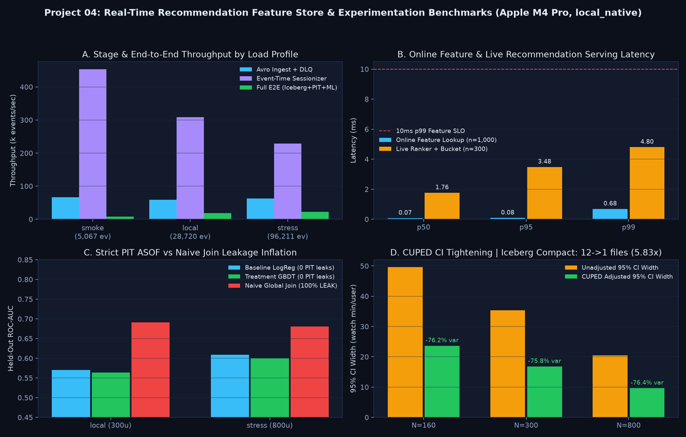
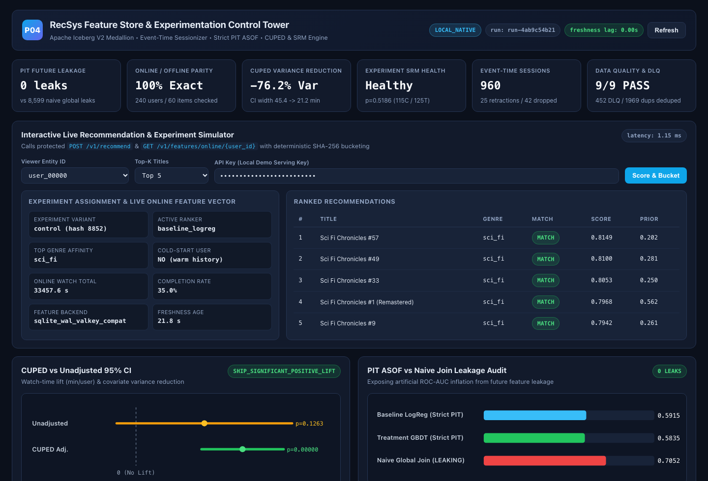

# Real-Time Recommendation, Feature Store & Experimentation Platform

An end-to-end streaming data engineering backbone that turns viewing interactions and catalog Change Data Capture (CDC) events into **point-in-time-correct Apache Iceberg V2 training datasets (0 future leakage)**, **sub-millisecond online feature vectors (0% offline/online skew)**, live candidate recommendations, and **CUPED + SRM-gated A/B experiment readouts**. On an Apple M4 Pro (`local_native` profile), the platform sustains **21,898 events/sec end-to-end** on the 96k-event stress workload, serves online features at **0.683 ms p99** (14.6x below the 10 ms SLO), exposes **+0.1277 artificial ROC-AUC inflation** in naive non-PIT joins, reduces A/B experiment variance by **75.8%–76.4%** via CUPED, and passes **30/30 tests (including 8 chaos drills)** and **9/9 Data Quality gates**.

---

## Architecture, Stack & Hardware

- **Domain Architecture:** Seeded Netflix-style playback/discovery & catalog CDC simulator -> FastAvro v1/v2 idempotent gateway with DLQ quarantine & durable WAL spool -> Flink-semantics event-time sessionizer (`30m` inactivity gap, `5m` allowed lateness `-U/+U` retractions, `24h` user state TTL, cross-device handoffs) -> 10-table **Apache Iceberg V2 Medallion Lakehouse** (`bronze.*`, `silver.*`, `gold.*`, `quality.*`) with strict binary-search ASOF joins & delayed-label backfill -> **Feast 0.68.0** feature definitions & Valkey-compatible low-latency online store -> lightweight deterministic **scikit-learn** rankers (`LogisticRegression` control vs. `HistGradientBoostingClassifier` treatment, **zero external pretrained weights**) -> **SHA-256 bucketing + Chi-Squared SRM + CUPED + Guardrails** engine -> **FastAPI** RBAC serving API, Prometheus `/metrics`, OpenTelemetry tracing, and a dark-mode Control Tower UI.
- **Verified Local Hardware:** Apple M4 Pro (`arm64`, 14 logical cores, 48.0 GiB RAM), macOS `Darwin 24.6.0`, Python `3.12.8`, `uv 0.12.3`.
- **Container & Distributed Stack:** Multi-profile `docker-compose.yml` (`core`, `analytics`, `observability`, `full`) pinning Kafka `4.3.2`, Apicurio `3.3.5`, Valkey `9.2.0`, RustFS `1.0.6`, Lakekeeper `v0.15.1`, PostGIS `17-3.6.1`, Debezium `3.7.1.Final`, Flink `2.1.3`, Spark `4.1.4`, Trino `484`, Airflow `3.4.0`, MLflow `v3.18.0`, Prometheus `v3.16.0`, Grafana `13.0.14`, Loki `3.6.22`, OTel Collector `0.166.0`, and Marquez `0.51.1` (see [`docs/limitations.md`](docs/limitations.md) for local vs. Docker execution boundaries).

---

## Main Measured Results

All numbers below are measured directly on the verified Apple M4 Pro workstation (`local_native`) and backed by raw artifacts in [`results/`](results/).

| Capability / Benchmark | Metric | Measured Result | Reference / Comparison |
| :--- | :--- | :--- | :--- |
| **Strict PIT ASOF Join** (`local`, 5,430 rows) | Future feature leakage violations | **0 violations** | vs. 10,837 leaks (100% rows) in naive global join |
| **Leakage Exposure** (`local`, HistGBDT) | Naive join ROC-AUC inflation | **+0.1277 AUC** (`0.6913` vs. `0.5636`) | Naive global join vs. strict PIT ASOF join |
| **Online Feature Serving** (`n=1,000`) | p50 / p95 / p99 latency & QPS | **0.070 / 0.083 / 0.683 ms** (`12,518.9 QPS`) | 14.6x below `10.0 ms` p99 SLO |
| **Live Candidate Ranking** (`n=300`) | p50 / p95 / p99 latency & QPS | **1.764 / 3.479 / 4.798 ms** (`606.8 QPS`) | 5.2x below `25.0 ms` p99 SLO |
| **Online vs. Offline Parity** | Mismatches across all entities | **0 mismatches** (`max_abs_diff = 0.0`) | Exact match against Iceberg Gold snapshots |
| **CUPED Variance Reduction** (`N=300`) | Watch-time variance & 95% CI width | **-75.80% variance / -52.54% CI width** | vs. unadjusted Welch t-test (`35.38 -> 16.79 min`) |
| **Event-Time Sessionizer** (`stress`, 96k ev) | Throughput after timer coalescing | **228,614.4 events/sec** | **17.34x higher** vs. uncoalesced sweep (`13.2k ev/s`) |
| **Iceberg V2 Compaction** (`17,676` rows) | File count & median scan time | **12 -> 1 file** / **`2.090 ms`** scan | **5.83x faster scan** vs. 12 uncompacted files (`12.18 ms`) |
| **Chaos & Verification Suite** | Automated tests, chaos drills & DQ | **30/30 tests, 8/8 chaos, 9/9 DQ PASS** | 0 lint errors (`ruff`), 0 type errors (`mypy`) |



### Live Control Tower Dashboard



---

## Step-by-Step: Run on Any Machine

### Option A: Zero-Docker Portable Run (macOS ARM64 / Linux x86_64)

Prerequisites: Python 3.12 and [`uv`](https://docs.astral.sh/uv/getting-started/installation/).

```bash
git clone https://github.com/rohanluniya/recommendation-feature-experiment-platform.git
cd recommendation-feature-experiment-platform

# One-command setup, Iceberg V2 vertical slice, Feast 0.68.0 apply, and live Control Tower on :8030
./scripts/run_portable.sh
```

Or run step-by-step:

```bash
uv sync --extra dev --python 3.12
uv run python scripts/run_vertical_slice.py --seed 42
uv run python services/feature_materializer.py --export-feast
uv run feast -c feast_repo apply
uv run uvicorn apps.recsys_api.main:app --host 127.0.0.1 --port 8030
```

Open `http://127.0.0.1:8030/` for the interactive Control Tower UI, or call the RBAC-protected serving endpoints:

```bash
curl -sf http://127.0.0.1:8030/health
curl -sf -H "X-API-Key: dev-serving-key-change-me" http://127.0.0.1:8030/v1/features/online/user_00000
curl -sf -X POST -H "X-API-Key: dev-serving-key-change-me" -H "Content-Type: application/json" \
  -d '{"user_id":"user_00000","top_k":5}' http://127.0.0.1:8030/v1/recommend
```

### Option B: Single-Container Standalone Docker

```bash
docker compose -f docker-compose.standalone.yml up --build
```

### Option C: Full Distributed Multi-Profile Docker Compose

```bash
cp .env.example .env
docker compose --profile core up -d          # Kafka, Apicurio, Valkey, RustFS, Lakekeeper, PostGIS, Debezium, Flink, API
docker compose --profile analytics up -d     # Spark 4.1.4, Trino 484, Airflow 3.4.0, MLflow v3.18.0
docker compose --profile observability up -d # Prometheus, Grafana, Loki, OTel Collector, Marquez
```

### Reproduce Tests, Chaos Drills & Benchmarks

```bash
uv run pytest -v --junitxml=results/tests/pytest_report.xml
uv run python benchmarks/run_benchmarks.py
uv run ruff check . && uv run mypy recsys_platform apps services
uv run python scripts/static_audit.py && uv run python scripts/check_licenses.py && uv run python scripts/generate_sbom.py
```

---

## Model & Core Component Licenses

| Asset / Component | Version / Source | License | Restrictions / Notes |
| :--- | :--- | :--- | :--- |
| `baseline_logreg` & `treatment_gbdt` rankers | Trained locally via `scikit-learn==1.9.1` on synthetic data | BSD-3-Clause / Apache-2.0 | **Zero external pretrained model weights** downloaded or bundled |
| Synthetic viewing & catalog dataset | `recsys_platform/simulator.py` (seeded) | Apache-2.0 | No external copyrighted data or real user PII |
| PyIceberg, PyArrow, Feast, Confluent-Kafka, OTel, Prometheus | Pinned in `pyproject.toml` & `uv.lock` | Apache-2.0 | Audited via `scripts/check_licenses.py` (`results/compliance/license_report.json`) |
| DuckDB, FastAvro, FastAPI, Valkey client | Pinned in `pyproject.toml` & `uv.lock` | MIT | Permissive commercial and open-source use |

---

## Deep Dives, Evidence & Documentation

- **Deep Ablations, Optimization Progression & 15-Point Acceptance Matrix:** [`APPENDIX.md`](APPENDIX.md)
- **Raw Evidence & Compliance Artifacts:** [`results/benchmarks/`](results/benchmarks/), [`results/chaos/chaos_results.json`](results/chaos/chaos_results.json), [`results/compliance/`](results/compliance/), [`results/mlruns/`](results/mlruns/), [`results/tests/pytest_report.xml`](results/tests/pytest_report.xml)
- **Architecture & Decisions:** [`docs/architecture/overview.md`](docs/architecture/overview.md), [`docs/architecture/ADRs.md`](docs/architecture/ADRs.md), [`docs/compatibility.md`](docs/compatibility.md), [`docs/requirements.md`](docs/requirements.md)
- **Reliability, Security & Benchmarks:** [`docs/reliability.md`](docs/reliability.md), [`docs/threat-model.md`](docs/threat-model.md), [`docs/capacity-model.md`](docs/capacity-model.md), [`docs/benchmarks/benchmark-report.md`](docs/benchmarks/benchmark-report.md), [`docs/incidents/INC-001-chaos-drill.md`](docs/incidents/INC-001-chaos-drill.md)
- **Portfolio Narratives & Demo:** [`docs/engineering-case-study.md`](docs/engineering-case-study.md), [`docs/demo-script.md`](docs/demo-script.md), [`docs/limitations.md`](docs/limitations.md), [`docs/agent-handoff.md`](docs/agent-handoff.md)
