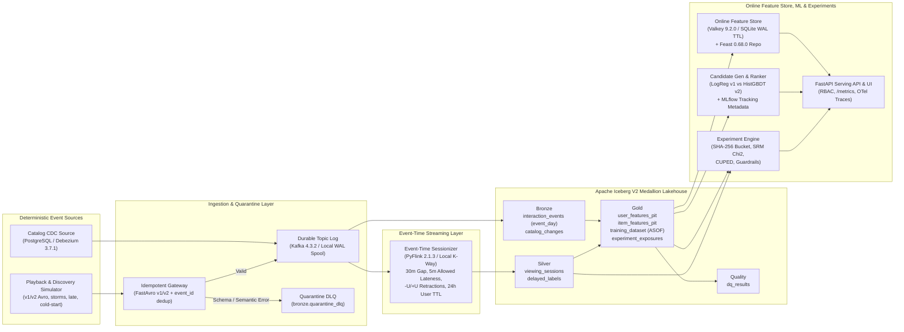
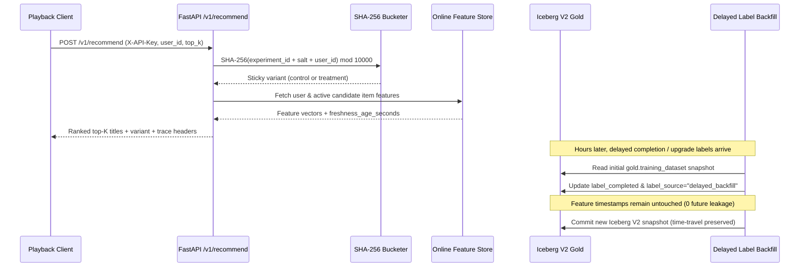
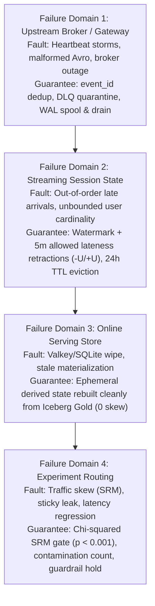

# Architecture Overview

## System Context & Component Topology

The platform converts streaming playback interactions and content catalog Change Data Capture (CDC) updates into point-in-time-correct offline training sets, sub-millisecond online feature vectors, ranked candidate lists, and statistically rigorous A/B experiment readouts.

## Core Workflow Sequence (Online Serving & Delayed Label Backfill)

## Failure Domains & Recovery Boundaries

## Data Model, Grain, Keys, Partitioning & Retention

| Table | Layer | Grain | Primary / Natural Key | Partitioning | Temporal Semantics | Retention Policy |
| :--- | :--- | :--- | :--- | :--- | :--- | :--- |
| `bronze.interaction_events` | Bronze | 1 deduplicated client interaction | `event_id` | Identity(`event_day`) | `event_ts_ms` vs `ingest_ts_ms` | 90 days |
| `bronze.catalog_changes` | Bronze | 1 catalog CDC change event | `change_id` | Unpartitioned (compact) | `event_ts_ms` SCD2 change log | Indefinite |
| `bronze.quarantine_dlq` | Bronze | 1 rejected/corrupt payload | `dlq_id` | Unpartitioned | `quarantined_ts_ms` | 30 days |
| `silver.viewing_sessions` | Silver | 1 user viewing session window | `session_id` | Unpartitioned | `session_start_ts_ms`..`session_end_ts_ms`, `revision` | 180 days |
| `silver.delayed_labels` | Silver | 1 delayed completion/upgrade | `label_id` | Unpartitioned | `request_ts_ms` vs `label_arrival_ts_ms` | 180 days |
| `gold.user_features_pit` | Gold | 1 user feature state snapshot | `(user_id, event_ts_ms)` | Unpartitioned | `event_ts_ms`, `created_ts_ms`, `ttl_seconds` | 365 days |
| `gold.item_features_pit` | Gold | 1 item feature/catalog state | `(item_id, event_ts_ms)` | Unpartitioned | `event_ts_ms`, `created_ts_ms`, `ttl_seconds` | 365 days |
| `gold.training_dataset` | Gold | 1 recommendation decision row | `row_id` | Unpartitioned | Strict ASOF (`user_feature_ts_ms < request_ts_ms`, `item_feature_ts_ms <= request_ts_ms`) | 365 days (Iceberg snapshots) |
| `gold.experiment_exposures` | Gold | 1 user session exposure | `exposure_id` | Unpartitioned | `exposure_ts_ms` + pre-experiment covariate `X` | 365 days |
| `quality.dq_results` | Quality | 1 DQ assertion per run | `check_id` | Unpartitioned | `checked_ts_ms` | 180 days |

## Explicit Consistency & Delivery Boundaries

- **Ingestion:** At-least-once delivery from upstream clients and topic spool; **idempotent effects** achieved via `event_id` deduplication before Bronze commit and inside the sessionizer state store.
- **Session Windows:** Event-time processing with 30s out-of-order watermark bound, 30m inactivity gap, and 5m allowed lateness emitting `-U`/`+U` retractions. Events arriving past `window_end + gap + allowed_lateness` are explicitly dropped to side-output counters rather than silently mutating expired state.
- **Iceberg Lakehouse:** Atomic snapshot commits via Iceberg V2 metadata (`format-version=2`). Delayed label backfills write a new snapshot without rewriting historical feature timestamps, enabling deterministic time-travel auditing.
- **Online Feature Store:** Eventually consistent derived projection of Iceberg Gold materialized on schedule (or on-demand rebuild). Parity is continuously verified against Iceberg Gold (`mismatch_ratio == 0.0`).
