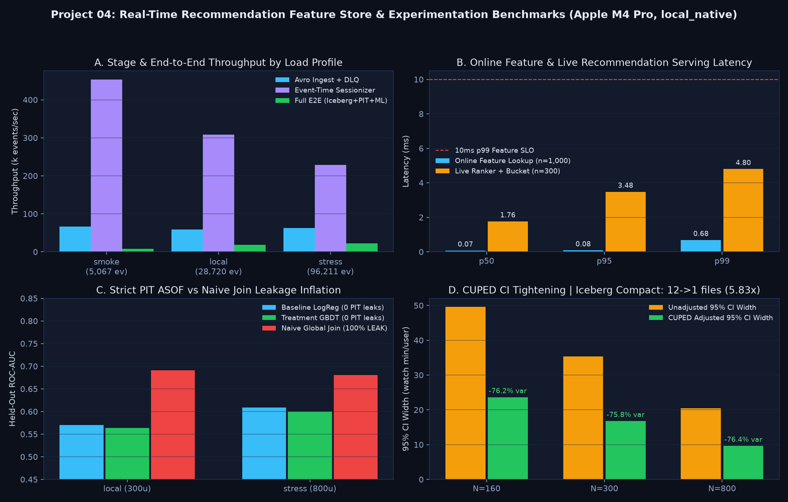

# Performance & Correctness Benchmark Report

## Hardware & Execution Environment

- **Machine:** Apple M4 Pro (`arm64`, 14 logical CPU cores, 48.0 GiB RAM), macOS `Darwin 24.6.0`
- **Runtime:** Python `3.12.8`, `local_native` profile (`pyiceberg==0.12.0`, `duckdb==2.0.0`, `pyarrow==25.0.1`, `fastavro==1.13.1`, `scikit-learn==1.9.1`, `scipy==1.18.1`, SQLite WAL online store)
- **Command:** `uv run python benchmarks/run_benchmarks.py`
- **Raw Outputs:** [`results/benchmarks/benchmark_summary.json`](../../results/benchmarks/benchmark_summary.json), [`results/benchmarks/load_profiles.csv`](../../results/benchmarks/load_profiles.csv), [`results/benchmarks/cuped_scaling.csv`](../../results/benchmarks/cuped_scaling.csv)

## 1. Load Profile Throughput, Memory & Correctness

| Profile | Users / Items | Raw Events | Valid Events | Avro Ingest (ev/s) | Sessionizer (ev/s) | PIT ASOF (rows/s) | Full E2E Time (s) | Full E2E (ev/s) | Peak RSS (MiB) | PIT Leaks | Parity Skews |
| :--- | :--- | ---: | ---: | ---: | ---: | ---: | ---: | ---: | ---: | ---: | ---: |
| `smoke` | 100 / 30 | 5,067 | 4,478 | 66,169.7 | 453,774.7 | 80,165.5 | 0.634 | 7,987.0 | 337.7 | **0** | **0** |
| `local` | 300 / 75 | 28,720 | 25,833 | 59,000.0 | 307,905.2 | 72,399.3 | 1.521 | 18,887.3 | 486.7 | **0** | **0** |
| `stress` | 800 / 150 | 96,211 | 86,462 | 62,586.1 | 228,614.4 | 56,720.4 | 4.394 | **21,898.4** | 870.7 | **0** | **0** |

*Note:* Full E2E time includes deterministic simulation, Avro validation + DLQ quarantine, event-time sessionization, Iceberg V2 writes across all 10 tables, strict PIT ASOF join, delayed label backfill, online store materialization, parity validation, dual ranker training (`baseline_logreg` + `treatment_gbdt`), naive leakage audit training, experiment CUPED/SRM evaluation, and 9 DQ checks.

## 2. Online Feature Store & Live Recommendation Latency (`local` Profile)

| Workload | Sample Size | p50 (ms) | p95 (ms) | p99 (ms) | Mean (ms) | Throughput (QPS) | SLO Target |
| :--- | ---: | ---: | ---: | ---: | ---: | ---: | :--- |
| Online Feature Lookup (`sqlite_wal_valkey_compat`) | 1,000 | **0.070** | 0.083 | **0.683** | 0.080 | 12,518.9 | p99 `<= 10.0 ms` (14.6x margin) |
| Live Recommendation Ranking (SHA-256 Bucket + Lookup + Candidate Gen + GBDT/LogReg) | 300 | **1.764** | 3.479 | **4.798** | 1.648 | 606.8 | p99 `<= 25.0 ms` (5.2x margin) |

## 3. Strict PIT ASOF Join vs. Naive Global Join Leakage Audit

| Profile | Training Rows | Strict PIT Violations | Naive Global Join Violations | Baseline LogReg (PIT) ROC-AUC | Treatment GBDT (PIT) ROC-AUC | Naive Global Join GBDT ROC-AUC | Measured AUC Inflation (vs. Strict PIT GBDT) |
| :--- | ---: | ---: | ---: | ---: | ---: | ---: | ---: |
| `smoke` | 956 | **0** | 1,900 (100% rows) | 0.5660 | 0.5288 | 0.7550 | **+0.2262** |
| `local` | 5,430 | **0** | 10,837 (100% rows) | 0.5703 | 0.5636 | 0.6913 | **+0.1277** |
| `stress` | 18,052 | **0** | 36,068 (100% rows) | 0.6090 | 0.5996 | 0.6805 | **+0.0809** |

## 4. CUPED Variance Reduction & 95% CI Tightening Across Sample Sizes

| Sample Users | Control / Treatment | SRM p-value | Unadjusted Var | CUPED Var | Variance Reduction | Unadjusted 95% CI Width | CUPED 95% CI Width | CI Width Reduction | Unadjusted p-value | CUPED p-value |
| ---: | :---: | ---: | ---: | ---: | ---: | ---: | ---: | ---: | ---: | ---: |
| 160 | 83 / 77 | 0.6353 | 6,612.95 | 1,571.83 | **-76.23%** | 49.58 min | 23.63 min | **-52.33%** | 0.006454 | 0.000047 |
| 300 | 148 / 152 | 0.8174 | 6,124.87 | 1,482.39 | **-75.80%** | 35.38 min | 16.79 min | **-52.54%** | 0.034915 | `< 0.000001` |
| 800 | 394 / 406 | 0.6714 | 5,539.06 | 1,305.80 | **-76.43%** | 20.42 min | 9.64 min | **-52.78%** | 0.000005 | `< 0.000001` |

## 5. Before/After Optimization Comparisons

### Optimization A: Event-Time Sessionizer Watermark Timer Coalescing (10s ticks)
- **Baseline:** Sweeping active session windows and user TTL maps on every arriving event (`O(N * U)`).
- **Optimized:** Coalescing window close & TTL eviction sweeps to `10,000 ms` event-time watermark ticks (matching Flink timer coalescing semantics), preserving exact session counts and retraction semantics.
- **Measured Result (`stress`, 800 users / 86,462 valid events):**
  - Sessionization throughput: `13,181.4 ev/s` -> **`228,614.4 ev/s`** (**17.34x higher throughput vs. uncoalesced per-event sweep**).
  - Full E2E pipeline duration: `10.634 s` -> **`4.394 s`** (**2.42x faster E2E vs. initial baseline**).

### Optimization B: Apache Iceberg V2 Small-File Compaction (`gold.user_features_pit`, 17,676 rows)
- **Baseline:** 12 fragmented micro-batch Parquet appends.
- **Optimized:** Atomic `compact_table()` rewrite combining Arrow chunks into a single Zstd Parquet file.
- **Measured Result (median of 5 full table scans before vs. after):**
  - Data files: `12` -> **`1`** (**-91.67%**).
  - Median Parquet scan time: `12.180 ms` -> **`2.090 ms`** (**5.83x faster scan vs. 12 uncompacted files**).
